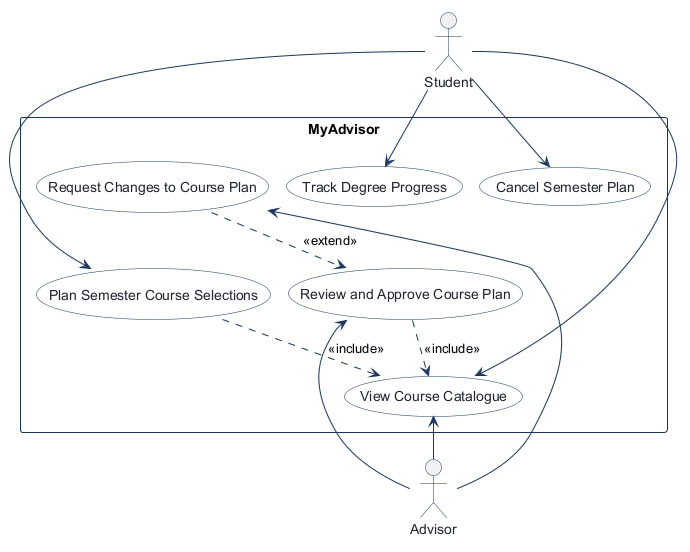
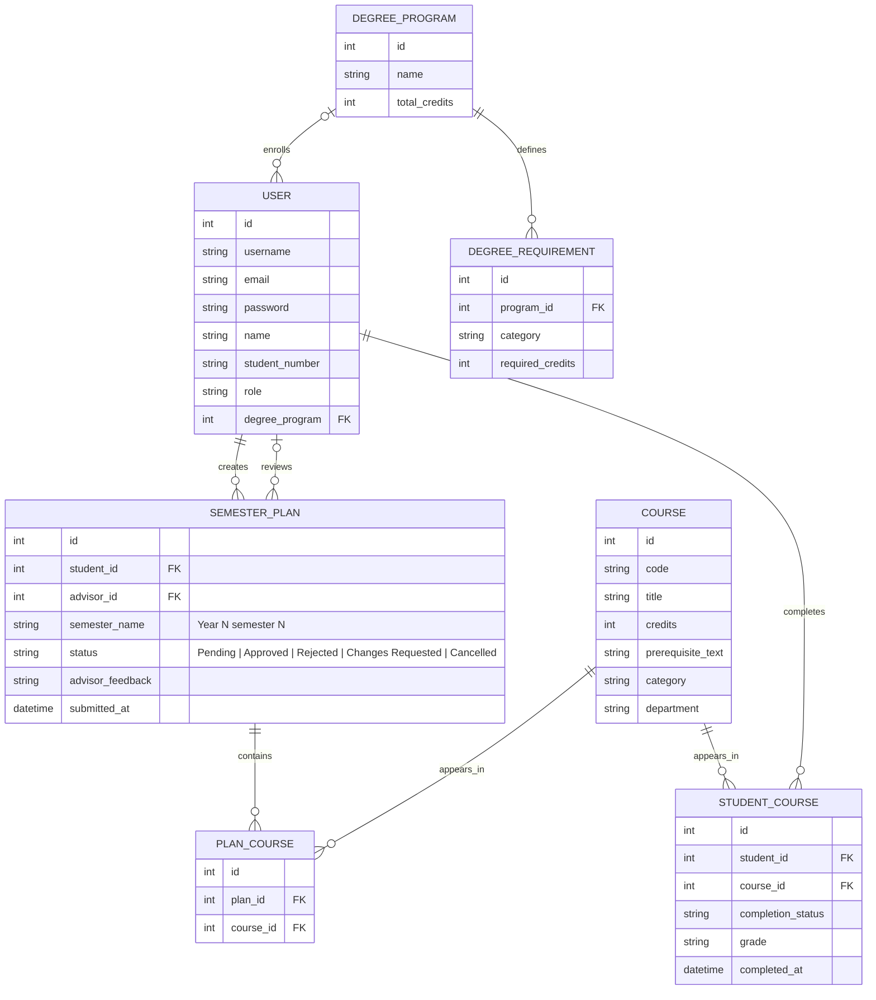
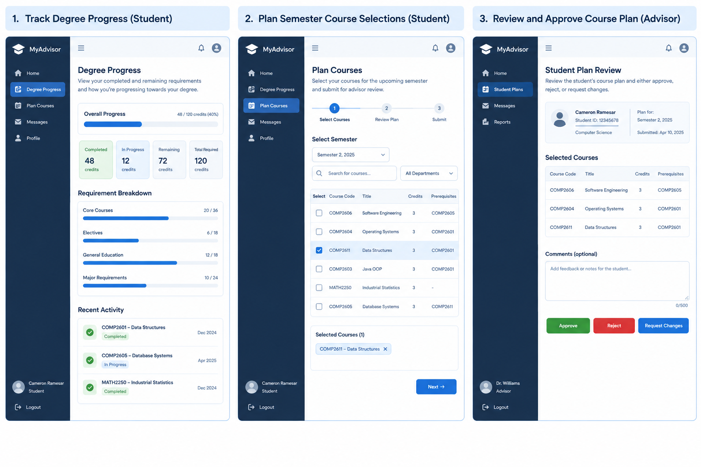

<!-- student-build:skill-integrity
status: pass
root: e84cd692d0b85eefe546385661958c27d07e8be6c5176a82012f68ccff5c8beb
expected_root: e84cd692d0b85eefe546385661958c27d07e8be6c5176a82012f68ccff5c8beb
mismatches: none
-->

# COMP 3613 Assignment 1

Draft this file with the Guide. **Update it after every phase milestone** before you pause. The use-case diagram is a UML PNG at `docs/diagrams/use-case.png`, linked from this file as `diagrams/use-case.png` (path relative to `docs/report.md`). The model diagram is Mermaid. **Embed wireframe images** as `wireframes/<file>` (files live in `docs/wireframes/`).

Do not put your student ID in this file if you will commit it. The PDF cover adds your name and ID at export time.

## Assigned project

MyAdvisor

## Three workflows

### 1. Track Degree Progress (Student)

Students can view their completed and remaining requirements, compare them to the degree plan, and understand where they stand academically.

### 2. Plan Semester Course Selections (Student)

Students select courses for the upcoming semester, check prerequisite eligibility, submit a plan for advisor review, and can cancel an existing plan.

### 3. Review and Approve Course Plan (Advisor)

Advisors review student plans, approve or reject them, or request changes for resubmission.

### Additional use cases

- **Cancel Semester Plan (Student):** Students may cancel a plan while it is Pending, Rejected, or Approved.
- **Request Changes to Course Plan (Advisor):** Advisors may request changes while reviewing a submitted plan. This use case `<<extend>>`s **Review and Approve Course Plan**.

## Use case diagram

## Model diagram

Revised in Phase 5 to support the degree-progress totals and requirement breakdown in the wireframe, plus profile, catalog, and plan-review details.

**Semester-plan business rules:** `semester_name` follows the exact pattern `Year X semester Y` (for example, `Year 1 semester 1`). The plan status may be Pending, Approved, Rejected, Changes Requested, or Cancelled. The student may cancel a plan in Pending, Rejected, or Approved status.

## Wireframes

### MyAdvisor dashboard mockup

<!-- student-build:wireframe-coverage
use_case: Track Degree Progress (Student)
image: docs/wireframes/Three-Panel Student Advisor Dashboard Mockup.png
covered: yes
-->

<!-- student-build:wireframe-coverage
use_case: Plan Semester Course Selections (Student)
image: docs/wireframes/Three-Panel Student Advisor Dashboard Mockup.png
covered: yes
-->

<!-- student-build:wireframe-coverage
use_case: Review and Approve Course Plan (Advisor)
image: docs/wireframes/Three-Panel Student Advisor Dashboard Mockup.png
covered: yes
-->

This single wireframe covers the three named workflows in a dashboard-style layout for the student advising flow.

### Three Panel Student Advisor Dashboard Mockup

## Theming

Brand preference: professional blue academic theme.

Applied in the landing page, login page, and registration page by updating the global CSS tokens to a blue/white academic palette, a serif display wordmark, and a cleaner student-advisor dashboard treatment. The final visual style is professional, trustworthy, and suited to a university advising system.

## Implementation notes

Phase 5 implements the three wireframed workflows in the existing FastStarter app:

- Student workspace navigation uses the AdminLTE 4.10.0 Bootstrap sidebar with Bootstrap Icons and OverlayScrollbars. Its hamburger button explicitly calls AdminLTE's push-menu API to open and close the responsive sidebar and keeps its expanded state accessible to assistive technology. It provides Home, Degree Progress, Plan Courses, Messages, and Profile tabs; advisor-only Advisor Review navigation is included.
- Home is a distinct student overview with latest semester-plan status and advisor feedback, recent activity, and quick links; Degree Progress separately displays degree totals and category breakdowns.
- Shared text and Bootstrap/AdminLTE secondary text utilities on app screens are forced to a high-contrast dark blue-gray; the authenticated header account name uses the dark foreground color for visibility. The Plan Courses tab uses darker secondary and ineligible-course text for legibility, and all text—including the explanatory paragraph—in pending, approved, and cancelled plan notices is white on dark backgrounds. Headings, labels, links, status colors, placeholders, and landing footer text use stronger foreground colors against their backgrounds.
- Track Degree Progress (Student): displays completed, in-progress, remaining, and total degree credits; progress by degree requirement category; student/program profile details; and recent course activity.
- Plan Semester Course Selections (Student): provides nine semester choices across three years in the "Year X semester Y" format; semester 3 in each year is summer. The backend uses the same allowed semester names for dashboard selection and plan submission. The tab also supports course search and department filtering, prerequisite eligibility feedback, a review step with credit totals, and plan submission. The demo catalog contains additional computer science, mathematics, statistics, writing, and physics courses; demo seeding does not create any pre-submitted plans. Students can add and remove courses from selections, remove individual courses from pending submissions, cancel pending, rejected, or approved plans while retaining their history, and edit/resubmit rejected or changes-requested plans. After cancellation, a fresh selection creates a brand new plan for the same semester. Registration captures the student's name and student ID and associates new students with the default degree program.
- Review and Approve Course Plan (Advisor): shows student identity/program, submission date, selected courses, credit totals, and prerequisites. Advisors can approve, reject, or request changes with up to 500 characters of feedback.
- Advisor workspace: admins see only Home, Messages, Profile, and Advisor Review navigation. Home summarizes student and plan-review statistics, the pending queue, and recent decisions; Messages lists the advisor's own decisions and feedback; Profile shows advisor account details and review totals.
- Workflow usability polish: empty states offer relevant next steps; course searches explain when filters return no results; plan validation names the exact missing prerequisites or other eligibility issue; primary actions use solid buttons while secondary and cancellation actions use outlined buttons.
- Plan status visibility: the Cancel Plan action uses a high-contrast solid red button, and rejected/changes-requested notices use a dark amber background with white text so advisor feedback and the resubmission instruction remain readable.

Assignment 2 audit qualification (27 October 2026): the high-contrast descriptions above record earlier styling intent. The retained UAT captures show unresolved Advisor course-table contrast and Approved-notice explanatory-text contrast; they do not support a blanket readability sign-off. The [final quality audit](assignment2/final-quality-audit.md) also records authorization, SQLite integrity, registration validation and degree-requirement findings. This Assignment 1 report and its historical competency assessment are not the final Assignment 2 submission or an Assignment 2 grade.

Verification: automated advising service and rendered-screen tests cover progress calculations, prerequisite-specific validation, plan review, request-changes resubmission, submitted-course removal, cancellation of pending, rejected, and approved plans, creation of a fresh plan for the same semester, student and advisor navigation/dashboard views, empty-state actions, the expanded course catalog, and idempotent demo seeding. Run `python manage.py run` to verify the rendered screens and interactive planning controls locally.

Model update: degree programs and per-category requirements support progress summaries; student profiles, catalog metadata, completed-course timestamps, semester plans, and selected courses support the workflows. Student-course and plan-course pairs are unique, and plan submission time is recorded. Existing databases are upgraded on startup with the added columns while retaining their rows.

## Deployed app

The deployed MyAdvisor app is publicly available on Render. The landing page was reachable when checked on 2026-10-11.

Public Render URL (not localhost): https://faststarter-eh50.onrender.com

## Source repository

[MyAdvisor on GitHub](https://github.com/Camcoon/MyAdvisor)

## Logins

Every account a marker needs, including extra users you added. Starter accounts:

- bob / bobpass — regular user
- admin / adminpass — admin

## YouTube URL

[Unlisted presentation](https://youtu.be/obRfsBjHgFU)

## Session transcripts

Filled when the Guide builds the report: the agent writes chat markdown into `docs/transcripts/`; `python manage.py report` packages them.

Guide packaged **1** chat(s) in `docs/transcripts/` (and `docs/transcripts.zip`).

Index: [docs/transcripts/INDEX.md](transcripts/INDEX.md)

- [`current-report-export`](transcripts/current-report-export.md)

## Competency (student-judge)

Filled by Guide from the student-judge run when this report was built.

**Student / session:** Cameron Ramesar / current report-export chat
**Artifact:** Current visible chat and project artefacts. A refreshed local index contained this session without turn records; other indexed chats were for a different course. No earlier project Guide transcript was available.
**Phases in evidence:** 1–6 appear in the current report and artefacts; historical phase conversations are not available to assess process.
**Judged at:** 2026-10-11T00:45:24-04:00
**Evidence pass:** Re-read current `docs/report.md`, `docs/diagrams/`, and `docs/wireframes/`; inspected the current chat and refreshed local session index; fetched the supplied Render URL. Prior scorecard ignored.

### Totals
| | Count / value |
|--|--|
| Metrics on rubric | 12 (M1–M12) |
| N/A (excluded) | 11: M1–M9, M11–M12; no phase-specific Guide turns were accessible |
| Metrics scored | 1 |
| Scoreable max | 1 × 4 = 4 |
| Awarded total | 4 / 4 |
| **Overall (avg of scored)** | **4.0 / 4** |
| Impression mark | 20 / 20 (rubric fallback from the single scored metric; not a course grade) |

## Scorecard
| ID | Metric | Score / 4 | In avg | Evidence |
|----|--------|----------:|:------:|----------|
| M1 | Phase discipline | N/A | no | No accessible phase-specific chat. |
| M2 | Problem framing | N/A | no | No accessible phase-specific chat. |
| M3 | Decision ownership | N/A | no | No accessible phase-specific chat. |
| M4 | Artefact-before-code | N/A | no | Artefacts exist, but no accessible phase-specific chat to assess their use. |
| M5 | Verification habit | N/A | no | Report describes verification, but no accessible student verification turns. |
| M6 | Assignment fit | N/A | no | No accessible phase-specific chat to assess student-owned decisions. |
| M7 | Slice explanation | N/A | no | No accessible phase-specific chat or student code-check turns. |
| M8 | Prompt quality | N/A | no | The current prompt concerns report export, not a project build phase. |
| M9 | Response to pushback | N/A | no | No accessible phase-specific chat. |
| M10 | Integrity | 4 | yes | Current chat asks for normal report/export work; report integrity stamp says `status: pass`; no laundering indicators were visible. |
| M11 | Provenance continuity | N/A | no | Earlier project chats are unavailable, so continuity cannot be checked. |
| M12 | Sincerity trajectory | N/A | no | No sincerity blocks or phase-specific chat history were available. |

## Strengths
- The report contains the MyAdvisor workflows, use-case diagram, Mermaid model, wireframes, implementation notes, and marker logins.
- The supplied Render URL loaded the MyAdvisor landing page when fetched on 2026-10-11.
- The current report records skill-integrity status as pass.

## Gaps (priority order)
- No student-performance gap can be established from the accessible project chat evidence.

## Evidence limitation
The archive can include only the current report-export conversation. The refreshed local session index contained no prior project Guide turns, and `docs/transcripts/` had no chat markdown. Therefore this scorecard does not assess the earlier project phases or establish that all historical chats are included.

## Phase gate status
| Phase | Status | Note |
|-------|--------|------|
| 1 | met (artefact) | MyAdvisor and three named workflows appear in the report; student ownership is not assessable from available chats. |
| 2 | met (artefact) | Use-case diagram is present and linked. |
| 3 | met (artefact) | Mermaid ERD is present. |
| 4 | met (artefact) | Wireframe image and coverage notes are present. |
| 5 | partial | The report documents implementation and polish; historical student verification turns are unavailable. |
| 6 | met | The supplied public URL loaded the MyAdvisor landing page; logins are listed in the report. |

## Recommended next practice
- Preserve the earlier Guide phase chats in `docs/transcripts/` when available so a future assessment can score student process and ownership rather than artefacts alone.

## Integrity note
- Clean for the accessible current chat; skill-integrity stamp in the current report is pass. Historical chats were unavailable.

## Provenance flags
- None observed in the accessible chat. Earlier project-phase provenance could not be checked.

## Sincerity log summary
- Blocks found: 0 | max round: N/A | min/mean/final confidence: N/A | trend: N/A | cleared: N/A (no suspicion protocol was triggered)

## Skips
- Skips: 0 evidenced in the accessible chat; earlier Guide chats unavailable.

## Skill integrity

Course skills are hashed at export and compared to `.agents/skills.lock.json`. Do not edit `.agents/skills/`, `.cursor/skills/`, or `AGENTS.md`.

- Status: **pass**
- Root: `e84cd692d0b85eefe546385661958c27d07e8be6c5176a82012f68ccff5c8beb`
- none

## Assignment 2: API security foundation

The API reuses the existing `access_token` login cookie. API routes require a valid signed, unexpired token identifying an existing user; authentication failures return JSON 401. Shared role guards check the current database role and return 403 when permission is missing. `/api/users` is restricted to admins and retains the response allowlist of ID, username, and email. HTML login redirects, dashboard rendering, and logout retain the existing cookie flow; unauthenticated dashboard requests render the session-expired page with HTTP 401.

Automated verification: `.venv\Scripts\python.exe -m pytest tests -q -p no:cacheprovider` completed with **71 passed**, with one Starlette TestClient dependency deprecation warning. Security tests use an isolated in-memory database and cover invalid cookies and claims, denied user enumeration, response field filtering, role changes, default API protection, and HTML authentication compatibility. Degree planning and advisor workflow business logic were not changed.

## Assignment 2: Workflow 1 and course catalogue API

Added student-only `GET /api/degree-progress` and `GET /api/courses`. Thin routes call AdvisingService adapters; progress reuses the HTML dashboard calculations, and catalogue selection reuses the existing repository catalogue and eligibility service. Pydantic response allowlists exclude account details, grades and advisor messages. Student identity comes exclusively from the authenticated cookie, current database roles enforce access, and personalized responses prohibit caching. The HTML dashboard remains unchanged. No semester plan submission or advisor decision API was added.

Automated verification on 26 October 2026: **95 tests passed**, including 24 new API cases; one existing Starlette/httpx deprecation warning remains. Coverage includes JSON response structure, calculations and boundaries, prerequisite eligibility, student isolation, unauthenticated denial, role restrictions and changes, OpenAPI models, and preserved HTML rendering. This records automated verification only. See [API documentation](assignment2/api.md) and [test-plan traceability and execution evidence](assignment2/evidence/workflow1-api.md).

## Assignment 2: Workflow 2 semester plan API

Added student-only `/api/semester-plans` resources for listing and viewing owned plans, submitting eligible selections, revising/resubmitting permitted plans, removing selected courses, and cancelling permitted plans. Routes call AdvisingService and reuse AdvisingRepository methods. The existing semester, prerequisite, duplicate-selection, status and cancellation rules remain in the service. Typed domain errors remain ValueErrors for the HTML form handlers and become structured JSON API errors with suitable status codes. Request allowlists reject identity and advisor-controlled fields, and missing/foreign plans return identical 404s. Repository transactions and API rollback handling protect failed writes; cancelled plan history is retained. Existing browser forms continue to redirect and render HTML. Advisor decision APIs were not added.

Automated verification on 26 October 2026: **216 tests passed**, including **121 new Workflow 2 integration cases** using real HTTP/authentication/service/repository behavior and isolated SQLite with foreign keys enabled. Scoped Ruff checks passed. Tests cover all plan states, student isolation, invalid inputs, current prerequisite checks, browser form compatibility, and database-triggered write failures with fresh-session rollback assertions. One existing Starlette/httpx deprecation warning remains. These are automated results; manual browser acceptance and production database verification are not claimed. See [endpoint documentation](assignment2/api.md) and [Workflow 2 execution evidence](assignment2/evidence/workflow2-api.md).

## Assignment 2: Workflow 3 advisor plan review API

Added `/api/advisor/plans` for the existing shared Pending queue, individual plan details, generic review decisions, and dedicated approval, rejection and change-request actions. All endpoints use the same current-database `admin` role guard as the advisor dashboard; students and unknown roles cannot access these resources or submit decisions. Thin routes reuse AdvisingService and AdvisingRepository. Existing allowed decisions and transitions, optional feedback, the 500-character limit before trimming, and authenticated advisor attribution are preserved. Typed errors provide JSON 404/409/422 responses while retaining ValueError compatibility with the existing forms. Conditional repository updates prevent a stale Pending read from overwriting a newer decision or cancellation. Database failures roll back and return sanitized JSON. Response allowlists expose only the review details needed by advisors. The original dashboard, form and JSON form submission behavior remain available.

Automated verification on 26 October 2026: the full application suite completed with **409 passed in 12.29 seconds**, including **193 new Workflow 3 integration cases** and all 216 existing tests. Scoped Ruff checks and `git diff --check` passed. Coverage includes all six endpoints, role checks and revocation, persisted decisions and feedback boundaries, malformed input and spoofed identity fields, all nonpending statuses, deterministic stale reads, database-triggered failures, student visibility and original dashboard/form compatibility. One existing Starlette/httpx deprecation warning remains. These results establish automated SQLite integration verification; manual browser acceptance and production/Postgres verification are not claimed. See [endpoint documentation](assignment2/api.md) and [Workflow 3 execution evidence](assignment2/evidence/workflow3-api.md).

## Assignment 2: Student integration test plan implementation

Added 59 student integration cases using FastAPI TestClient, real password/cookie authentication and fresh in-memory SQLModel databases. They cover progress and catalogue retrieval, valid plan submission/persistence/retrieval, semester and course validation, duplicate active plans, permitted removal/resubmission/cancellation, and cross-student ownership. Each case links to its approved IT identifier and uses the integration marker. Fixtures isolate request, startup and recovery database access, reject connections to other engines, restore overrides/settings/lifespan, and compare fresh-session committed state. Existing tests and application code were retained.

Student-suite verification on 26 October 2026: **59 passed, 1 warning in 4.62s**, exit code 0; scoped Ruff checks passed. The warning concerns Starlette's httpx TestClient transport. The full suite and advisor-specific cases were not run for this task. See [student IT traceability and actual execution output](assignment2/evidence/student-integration.md).

## Assignment 2: Full-suite verification and Postman collection creation

On 26 October 2026, the student confirmed that the pytest temporary-directory
problem was resolved using a dedicated writable `MyAdvisor-A2-Pytest` directory.
The full `tests` run with `-v` and `--basetemp` completed with **715 passed,
1 warning in 56.83s**, with no pytest failures or setup errors. This is the
student's verified result; the suite was not rerun for collection creation.

Prompt 11 creates a Postman Collection v2.1 with 86 sequential requests for the
implemented Student and Advisor APIs, real cookie authentication, dynamic
course/plan IDs, ownership checks, validation and plan review transitions.
Application functionality is unchanged. See the [collection and local run
instructions](assignment2/postman/README.md) and [progress record](assignment2/PROGRESS.md).
**Postman execution is pending; no Postman pass result is claimed.** Work stops
at collection creation.

## Owner-approved fictional degree requirements (27 October 2026)

Core Courses 36 + General Education 18 + Electives 12 + Major Requirements 18 + Additional Requirements 9 = **93 credits**, with each completed course assigned to one category. These are fictional demonstration requirements, not official UWI curriculum. The catalogue, prerequisites and existing academic/advising history are preserved. See the [correction, actual evidence and remaining acceptance](assignment2/reports/degree-requirement-correction.md); historical 735-pass/Runner/UAT records remain separately qualified. No remote change or push was performed.
